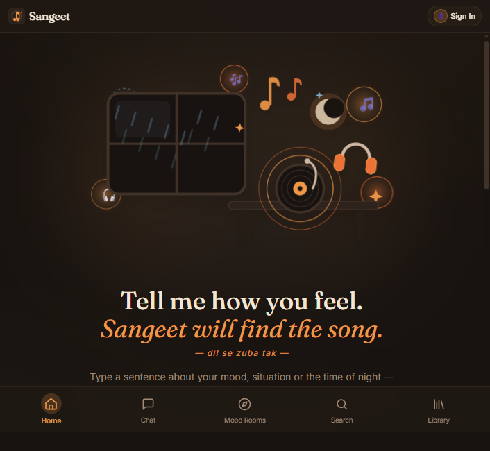
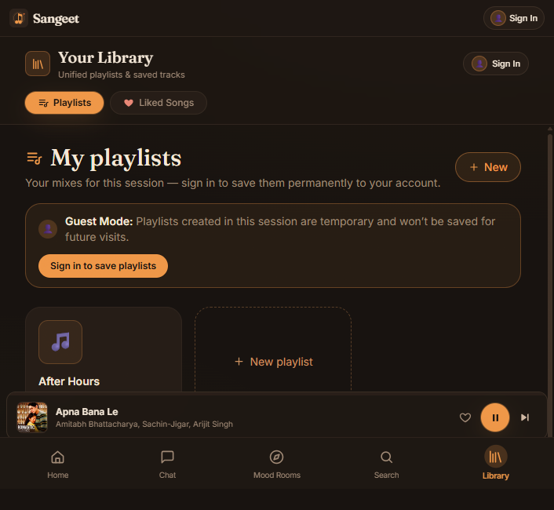
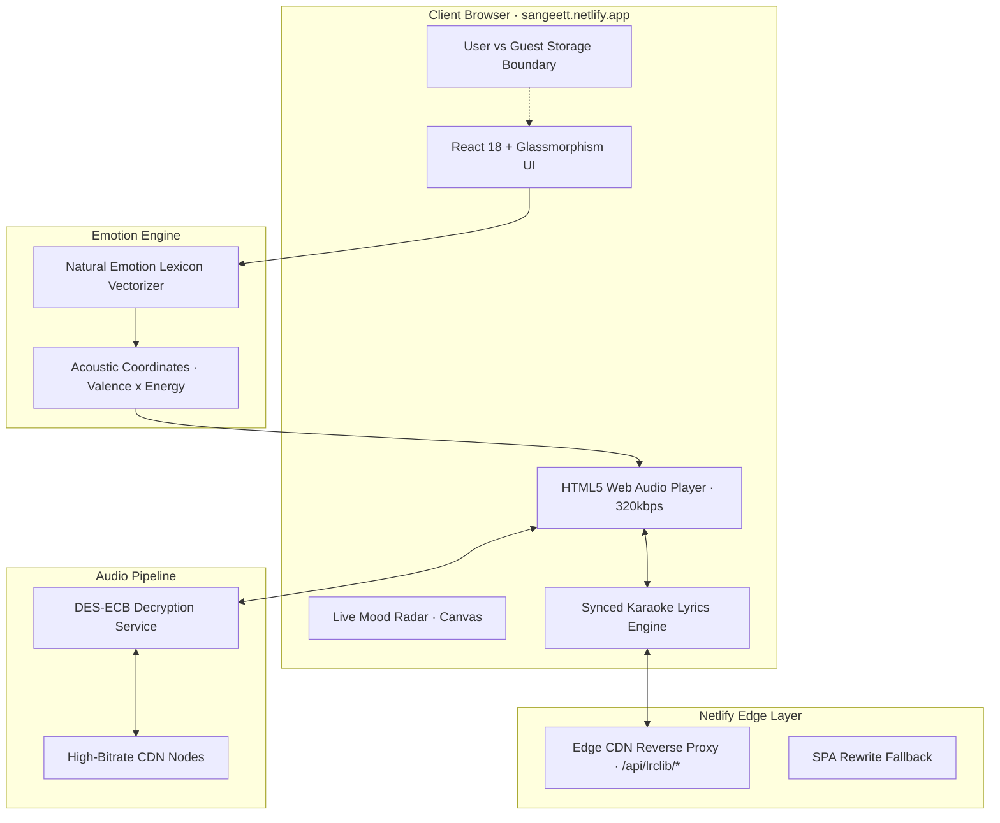

<div align="center">




<a href="https://sangeett.netlify.app/">
  
</a>

<br/>

[](https://sangeett.netlify.app/)
[](https://react.dev/)
[](https://vitejs.dev/)
[](https://www.python.org/)
[](https://flask.palletsprojects.com/)
[](https://sangeett.netlify.app/)


### 🎧 **[Open Sangeet →](https://sangeett.netlify.app/)**

</div>


## 📸 Take a Look

<div align="center">

<!-- 👇 Drop your screenshots into docs/screenshots/ using these exact names -->



<sub><b>Home</b> · describe your mood in one sentence and Sangeet finds the track</sub>

<br/><br/>

<table>
  <tr>
    <td align="center" width="50%">
      <br/>
      <sub><b>Mood Chat</b> · talk to it like a friend</sub>
    </td>
    <td align="center" width="50%">
      <br/>
      <sub><b>Mood Rooms</b> · 10 themed worlds</sub>
    </td>
  </tr>
  <tr>
    <td align="center" width="50%">
      <br/>
      <sub><b>Karaoke Lyrics</b> · line-by-line sync</sub>
    </td>
    <td align="center" width="50%">
      <br/>
      <sub><b>Playlists &amp; Library</b> · synced across devices</sub>
    </td>
  </tr>
</table>

<br/>

<!-- Optional: a screen recording makes the page come alive -->


<sub>▲ <b>Sangeet in action</b></sub>

</div>


## ✨ How It Feels

```text
 you   ▸  "heartbroken and it's raining at 2am"
          │
          ▼
 sangeet reads the mood ──▶ valence 0.18 · energy 0.32 · acousticness 0.81
          │
          ▼
 ♪  Kabhi Jo Baadal Barse  ·  Arijit Singh   ▶ playing in 320 kbps
```

> *Type a sentence about your mood, your situation, or the time of night. Sangeet maps it to musical features and plays a full track. No premium, no login.*


## ⚡ Superpowers

<table>
  <tr>
    <td width="50%" valign="top">
      <h3>🧠 Emotional Vector Intelligence</h3>
      Natural-language sentiment parsing that maps everyday phrases to acoustic targets (<b>valence</b>, <b>energy</b>, <b>danceability</b>, <b>acousticness</b>), with a live visual Mood Radar.
    </td>
    <td width="50%" valign="top">
      <h3>🎧 320 kbps Studio Fidelity</h3>
      Real-time DES-ECB decryption unwraps streams from high-speed CDNs, played through a custom HTML5 Web Audio engine.
    </td>
  </tr>
  <tr>
    <td valign="top">
      <h3>🎤 Synced Karaoke Lyrics</h3>
      Line-by-line lyrics with smooth auto-scroll and highlight, served through Netlify edge proxies and offline-first LRC caches.
    </td>
    <td valign="top">
      <h3>🔒 User &amp; Guest Isolation</h3>
      Registered users keep playlists and liked tracks synced across devices. Guests get a private, zero-trace temporary session.
    </td>
  </tr>
  <tr>
    <td valign="top">
      <h3>🌌 10 Infinite Mood Rooms</h3>
      Broken Heart, Rainy Night, Lo-Fi Focus, Gym Beast, Sufi Soul, Bollywood Retro and more, each expandable into endless tracks.
    </td>
    <td valign="top">
      <h3>📱 Glassmorphism Design</h3>
      An obsidian-and-ember interface with animated vinyl, tactile controls and a layout that adapts to every screen.
    </td>
  </tr>
</table>


## 🥊 Sangeet vs. The Usual Suspects

| Feature | Typical streaming apps | 🎵 Sangeet |
| :-- | :-- | :-- |
| **Audio bitrate** | 128 kbps free / 320 kbps paid | **320 kbps, free** |
| **Ads** | Audio and visual interruptions | **Ad-free** |
| **Search by feeling** | Rigid keywords and genre tags | **Conversational emotion vectoring** |
| **Guest play** | Sign-up required | **Zero-friction guest mode** |
| **Synced lyrics** | Often paywalled or missing | **Built-in karaoke engine** |
| **Custom mixes** | Algorithmic injection | **One-click personal mixes** |


## 🏗️ Under the Hood




## 🛠️ Tech Arsenal

<div align="center">


</div>

- **Frontend:** React 18, Vite, ES Modules, TailwindCSS, Inter and Outfit typography
- **Audio and lyrics:** HTML5 Web Audio API, LRCLIB line sync, custom LRC parser
- **Backend:** Python 3.10+, Flask REST API, PyCryptodome (DES-ECB)
- **Persistence:** MongoDB (PyMongo) with a thread-safe JSON store fallback and user-scoped isolation
- **Deployment:** Netlify edge CDN proxy with continuous delivery from GitHub


## 💻 Quick Start

Run everything locally in under a minute.

**Prerequisites:** [Node.js](https://nodejs.org/) v18+ and [Python](https://python.org/) v3.10+

```bash
# 1. Clone
git clone https://github.com/techprem324/sangeet.git
cd sangeet

# 2. Install
npm --prefix frontend install
pip install -r backend/requirements.txt

# 3. Launch
npm start
```

> **Windows:** double-click `start.bat` or run `.\start.ps1` in PowerShell.

| Service | URL |
| :-- | :-- |
| 🌐 Frontend | http://localhost:5173 (or http://localhost:5000) |
| ⚙️ Flask API | http://localhost:5000/api |
| 🩺 Health check | http://localhost:5000/api/health |


## 📡 API Overview

<details>
<summary><b>Click to expand all endpoints</b></summary>

<br/>

| Method | Route | Description |
| :-- | :-- | :-- |
| `POST` | `/api/chat` | Turns a mood prompt into emotion vectors and 320 kbps tracks |
| `POST` | `/api/mood` | Sentiment analysis returning valence, energy and genre affinities |
| `GET` | `/api/lyrics` | Synced karaoke lines `[{ t, text }]` for the active track |
| `GET` | `/api/catalog` | Curated mood room collections |
| `POST` | `/api/explore` | Expands a category into 500+ songs |
| `GET` | `/api/search` | Instant search across Bollywood, indie and international tracks |
| `GET` / `POST` | `/api/playlists` | User-isolated playlists and track management |
| `GET` / `POST` | `/api/liked` | User-isolated liked songs |
| `POST` | `/api/auth/login` | Sign in a registered user |
| `POST` | `/api/auth/register` | Create an account with an isolated library |

</details>


## 🗺️ Roadmap

- [x] Mood-to-music emotion engine
- [x] 320 kbps streaming with synced karaoke lyrics
- [x] Mood rooms, playlists and liked songs
- [x] Guest mode with isolated sessions
- [ ] Shareable mood links
- [ ] Collaborative playlists
- [ ] Installable PWA with offline queue

## 🤝 Contributing

Ideas and pull requests are welcome. Fork the repo, create a branch, and open a PR.

<div align="center">

<br/>

### 👨‍💻 Made with ❤️ by **[Prem Srivastava](https://github.com/techprem324)**

<sub><i>"Music shouldn't be trapped behind paywalls, subscription tiers, or impersonal algorithms. It should speak the language of what you feel right now."</i></sub>

<br/>

**[⚡ Visit the live app → sangeett.netlify.app](https://sangeett.netlify.app/)**

⭐ **Star this repo if Sangeet hit the right chord with you!**


</div>
