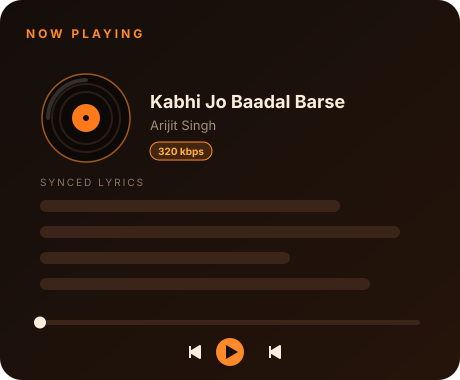
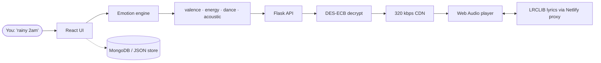

<div align="center">




<a href="https://sangeett.netlify.app/">
  
</a>

<br/>

[](https://sangeett.netlify.app/)
[](https://react.dev/)
[](https://flask.palletsprojects.com/)
[](https://sangeett.netlify.app/)

</div>

<br/>

<div align="center">

## 🎬 Feel → Vector → Song



</div>

<br/>

<div align="center">

## 📸 See It


<br/><br/>

<table>
  <tr>
    <td align="center" width="50%"><br/><sub><b>🔎 Search</b></sub></td>
    <td align="center" width="50%"><br/><sub><b>🎵 Music Player</b></sub></td>
  </tr>
  <tr>
    <td align="center" width="50%"><br/><sub><b>📚 Library</b></sub></td>
    <td align="center" width="50%"><br/><sub><b>🎧 Playlists</b></sub></td>
  </tr>
  <tr>
    <td align="center" width="50%"><br/><sub><b>🎼 Playlist Details</b></sub></td>
    <td align="center" width="50%"></td>
  </tr>
</table>

</div>

<br/>

<div align="center">

## 🌌 Mood Rooms



</div>

<br/>

<div align="center">

## 🧠 Live Mood Radar &nbsp;·&nbsp; 🎤 Synced Lyrics

<table>
  <tr>
    <td></td>
    <td></td>
  </tr>
</table>

</div>

<br/>

<div align="center">

## ⚡ Why It Hits Different

|  | Others | 🎵 Sangeet |
| :-- | :--: | :--: |
| Audio | 128 kbps free | **320 kbps free** |
| Ads | 😩 | **None** |
| Search | genre tags | **your feelings** |
| Login | required | **guest mode** |
| Lyrics | paywalled | **synced, built in** |

</div>

<br/>

<div align="center">

## 🧩 Stack


</div>

<details>
<summary><b>📁 Project layout</b></summary>

```text
frontend/                 React + Vite application and search tests
backend/                  Flask API, services, data, and scripts
backend/data/datasets/    Song source and cleaned datasets
docs/assets/              README illustrations
docs/screenshots/         Application screenshots
```

</details>

<details>
<summary><b>🏗️ Architecture</b></summary>



</details>

<details>
<summary><b>💻 Run it locally</b></summary>

```bash
git clone https://github.com/techprem324/sangeet.git
cd sangeet
npm --prefix frontend install
pip install -r backend/requirements.txt
npm start
```

Windows: run `start.bat` or `.\start.ps1`. App at `localhost:5173`, API at `localhost:5000/api`.

</details>

<details>
<summary><b>📡 API endpoints</b></summary>

| Method | Route | What it does |
| :-- | :-- | :-- |
| `POST` | `/api/chat` | Mood prompt → vectors + tracks |
| `POST` | `/api/mood` | Valence, energy, genre affinities |
| `GET` | `/api/lyrics` | Synced lyric lines |
| `GET` | `/api/catalog` | Mood room collections |
| `POST` | `/api/explore` | Expand a room to 500+ songs |
| `GET` | `/api/search` | Instant search |
| `GET` `POST` | `/api/playlists` | Playlists |
| `GET` `POST` | `/api/liked` | Liked songs |
| `POST` | `/api/auth/login` · `/register` | Accounts |

</details>

<br/>

<div align="center">

### Made with ❤️ by **[Prem Srivastava](https://github.com/techprem324)**

**[⚡ Open the app → sangeett.netlify.app](https://sangeett.netlify.app/)** &nbsp;·&nbsp; ⭐ Star if it hit the right chord


</div>
