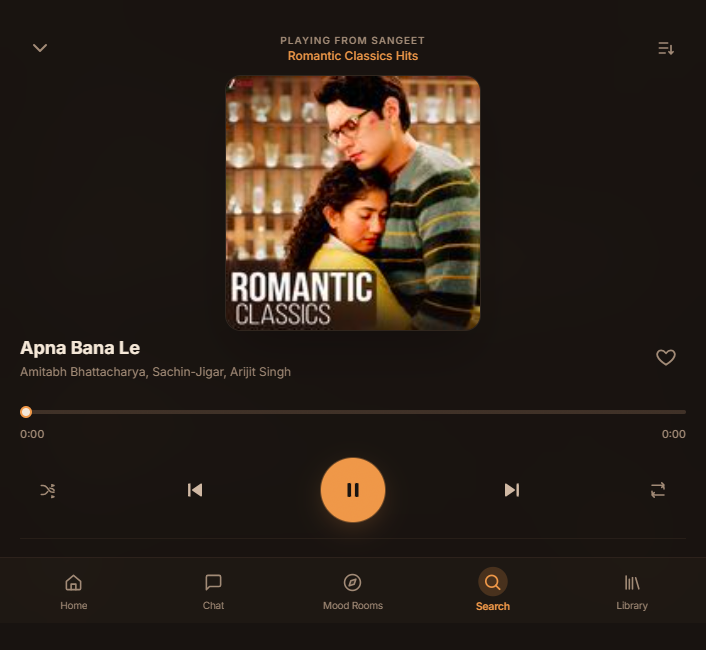
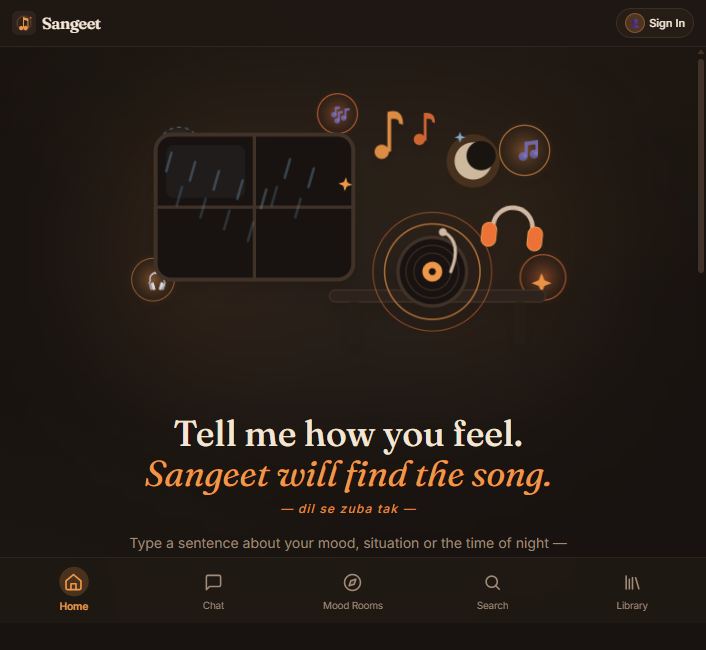
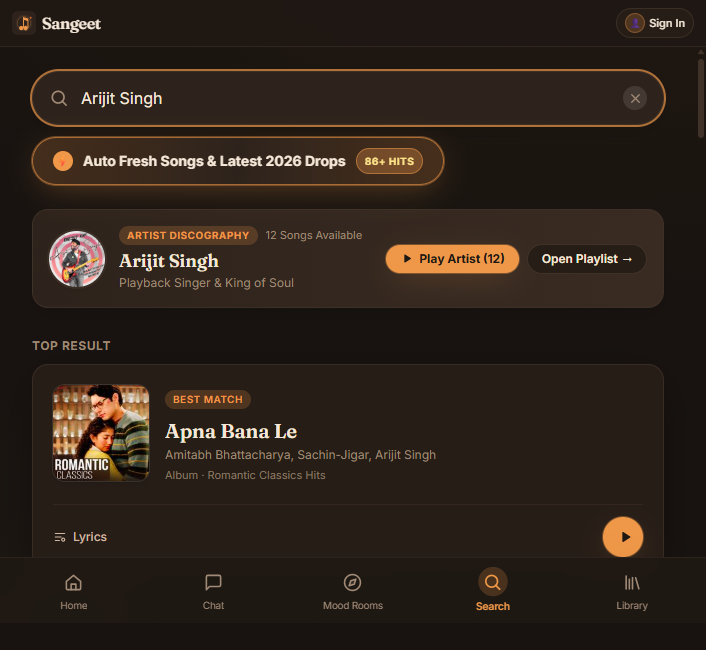
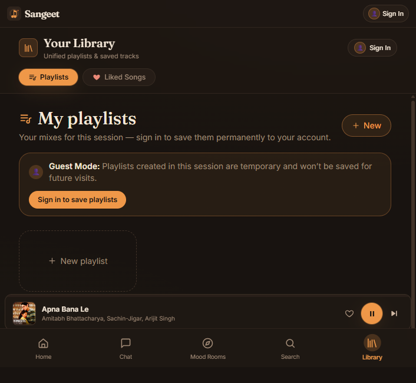
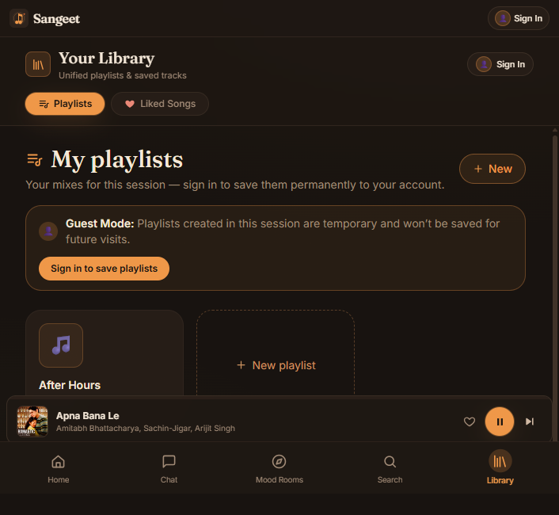
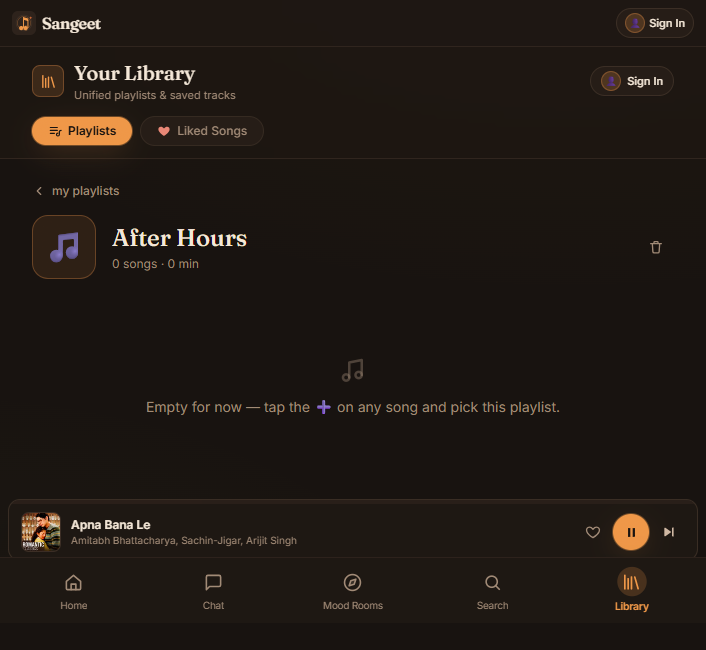
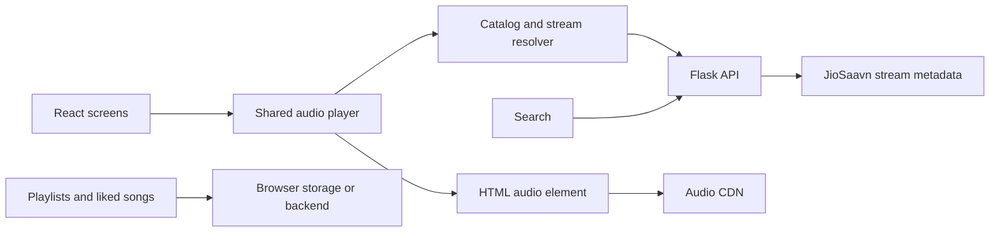
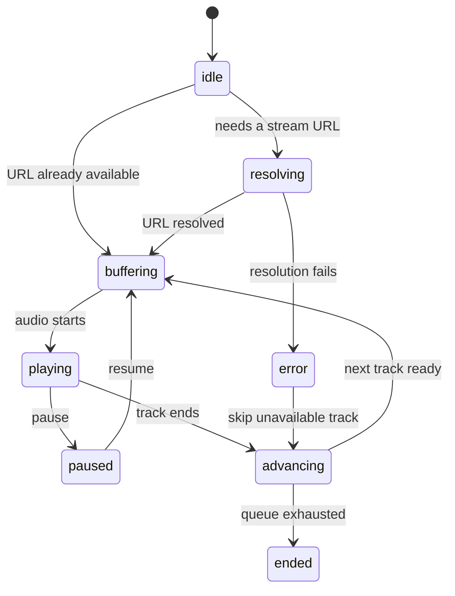

<div align="center">


# SANGEET
### Find the feeling. Press play.

**A music-discovery experience tuned to your mood, your memories, and the song stuck in your head.**

[](https://sangeett.netlify.app/)
[](https://react.dev/)
[](https://vite.dev/)
[](https://flask.palletsprojects.com/)

<br>

<a href="docs/screenshots/player.png">
  
</a>

<br>

**One player. A whole mood.**

[Listen live](https://sangeett.netlify.app/) &nbsp;·&nbsp;
[Playback audit](docs/PLAYBACK_AUDIT.md) &nbsp;·&nbsp;
[Test report](docs/TEST_REPORT.md)

</div>

---

## A little more Sangeet

Real screens, captured from the running production web build. No mockups.

<div align="center">
  <a href="docs/screenshots/home.png"></a>
  &nbsp;
  <a href="docs/screenshots/search.png"></a>
  &nbsp;
  <a href="docs/screenshots/player.png"></a>
</div>

<div align="center">
  <sub>01 — Meet your mood</sub>
  &nbsp;&nbsp;&nbsp;&nbsp;&nbsp;&nbsp;&nbsp;
  <sub>02 — Find your sound</sub>
  &nbsp;&nbsp;&nbsp;&nbsp;&nbsp;&nbsp;&nbsp;
  <sub>03 — Stay in the moment</sub>
</div>

<br>

<div align="center">
  <a href="docs/screenshots/library.png"></a>
  &nbsp;
  <a href="docs/screenshots/playlists.png"></a>
  &nbsp;
  <a href="docs/screenshots/playlist-detail.png"></a>
</div>

<div align="center">
  <sub>04 — Your collection</sub>
  &nbsp;&nbsp;&nbsp;&nbsp;&nbsp;&nbsp;&nbsp;
  <sub>05 — Make a mix</sub>
  &nbsp;&nbsp;&nbsp;&nbsp;&nbsp;&nbsp;&nbsp;
  <sub>06 — Set the scene</sub>
</div>

<sub><i>Captured in a 706 × 650 browser viewport from the local production build. The guest playlist is temporary demo data; the player image shows the UI, not verified audio output.</i></sub>

## The good stuff

| 🎭 Find your mood | 🔎 Find that song |
|---|---|
| Describe the moment or explore a mood room. | Search songs, artists, lyrics, and curated collections. |

| 🎧 Keep listening | 💿 Make it yours |
|---|---|
| A shared browser player, queue, repeat, shuffle, and browser media controls where supported. | Create playlists, choose a sort, shuffle a mix, and save songs. |

### Feature check

| Feature | Status |
|---|---|
| Web playback, queue, repeat, and shuffle | Implemented; see the [playback audit](docs/PLAYBACK_AUDIT.md) |
| Next-track URL pre-resolution | Implemented on a best-effort basis |
| Search debounce, recent searches, and stale-request cancellation | Implemented |
| Playlist creation, deletion, sorting, play-all, and shuffle | Implemented; drag-reorder/rename/duplicate are not |
| Native Android app or APK | Not part of this repository |

## Under the hood





The state diagram describes the intended lifecycle; it is not a native Android player or a separately enforced state-machine implementation.

## Run it yourself

**You’ll need:** Node.js 18+ and Python 3.10+.

```bash
git clone https://github.com/techprem324/sangeet.git
cd sangeet
```

### 2. Install frontend dependencies

```bash
npm --prefix frontend install
```

### 3. Install backend dependencies

Create and activate a virtual environment (recommended), then install the requirements.

**Windows PowerShell**
```powershell
py -m venv venv
.\venv\Scripts\Activate.ps1
pip install -r backend/requirements.txt
```

**macOS / Linux**
```bash
python3 -m venv venv
source venv/bin/activate
pip install -r backend/requirements.txt
```

### 4. Start the application

From the repository root:

```bash
npm start
```

Open the web app at `http://localhost:5173`. The Flask API runs at `http://localhost:5000`.

Build the production web app:

```powershell
npm --prefix frontend run build
```

The output is `frontend/dist/`. This repository has no Android/Capacitor project, so it cannot produce an APK.

## Playback: the honest version

The production frontend build and 13 backend service tests pass. Real screenshots are above; device playback timings and screen-off behavior have **not** been measured. Browser background playback depends on the device and browser, and is not a substitute for an Android foreground service.

See the detailed [playback audit](docs/PLAYBACK_AUDIT.md) and [test report](docs/TEST_REPORT.md) for what changed, test evidence, and remaining gaps.

## Credits

Echo Music was an architectural reference for separating playback from UI. **No Echo Music code was copied.**

Made by [Prem Srivastava](https://github.com/techprem324). Put on a song at [sangeett.netlify.app](https://sangeett.netlify.app/).

<div align="center">

### Dil se zuba tak. 🎵

</div>
