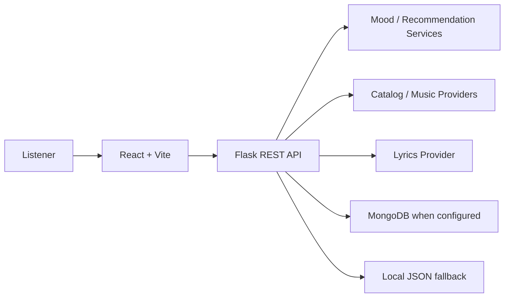

# 🎵 SANGEET — Dil Se Zuba Tak

<div align="center">

```
  ____                               _
 / ___|  __ _ _ __   __ _  ___  ___| |_
 \___ \ / _` | '_ \ / _` |/ _ \/ _ \ __|
  ___) | (_| | | | | (_| |  __/  __/ |_
 |____/ \__,_|_| |_|\__, |\___|\___|\__|
                    |___/
```

### *Where your emotions become soundwaves.*

[](https://sangeett.netlify.app/)
[](https://react.dev/)
[](https://vitejs.dev/)
[](https://www.python.org/)

---

</div>

## 🌐 Live Application

Experience Sangeet on web, mobile, tablet, or desktop:

👉 **[https://sangeett.netlify.app/](https://sangeett.netlify.app/)**

## ⚡ What is Sangeet?

Sangeet is a music discovery and listening experience built around mood-aware discovery, search, streaming, playlists, and lyrics. It combines a React frontend with a Python Flask API and provider-backed music services.

## ⚡ Core capabilities

- 🧠 **Mood-aware discovery:** natural-language mood analysis and recommendations.
- 🎧 **Music playback:** browser-based playback with track discovery and stream resolution.
- 🎤 **Lyrics:** lyrics lookup and synchronized-line support where available.
- 🔒 **Listener libraries:** account, guest, liked-track, and playlist flows.
- 🌌 **Mood rooms:** curated listening categories that can be expanded.
- 📱 **Responsive interface:** designed for desktop and mobile listening.

## 🏗️ Architecture at a glance



For the detailed, code-aligned explanation, see [Architecture Overview](docs/ARCHITECTURE_OVERVIEW.md) and [Architecture Deep-Dive](docs/ARCHITECTURE.md).

## 🛠️ Technology

- **Frontend:** React 18, Vite, JavaScript, Tailwind CSS.
- **Backend:** Python 3.10+, Flask REST API.
- **Data:** MongoDB when configured, with a local JSON fallback.
- **Integrations:** music discovery/stream services and lyrics lookup.
- **Deployment:** Netlify frontend configuration; backend deployment is configured separately.

## 💻 Quick Start

### Prerequisites

- [Node.js](https://nodejs.org/) 18+
- [Python](https://www.python.org/) 3.10+
- Git

### 1. Clone the repository

```bash
git clone https://github.com/techprem324/sangeet.git
cd sangeet
```

### 2. Install dependencies

```bash
npm --prefix frontend install
pip install -r backend/requirements.txt
```

### 3. Start locally

```bash
npm start
```

On Windows, the repository also includes `start.bat` and `start.ps1`.

- Frontend: http://localhost:5173
- Backend health: http://localhost:5000/api/health

For environment configuration, refer to [backend/.env.example](backend/.env.example). Never commit real secrets or production credentials.

## 📡 API Reference

See [docs/API.md](docs/API.md) for endpoint descriptions and example payloads.

## 🧭 Project Documentation

| Document | Purpose |
|---|---|
| [Architecture Overview](docs/ARCHITECTURE_OVERVIEW.md) | Current system components and request flows |
| [Architecture Deep-Dive](docs/ARCHITECTURE.md) | Existing implementation rationale and technical details |
| [API Reference](docs/API.md) | Current API routes and example responses |
| [Deployment Guide](docs/DEPLOYMENT.md) | Hosting, environment, release, and rollback guidance |
| [Production Readiness](docs/PRODUCTION_READINESS.md) | Prioritized path to safe public production operation |
| [Security Review](docs/SECURITY_REVIEW.md) | Source-level risks requiring remediation |
| [Contributing](CONTRIBUTING.md) | Setup, branch, testing, and pull request workflow |
| [Code of Conduct](CODE_OF_CONDUCT.md) | Community expectations |
| [Security Policy](SECURITY.md) | Private vulnerability reporting |
| [Support](SUPPORT.md) | Help and troubleshooting |

## 🤝 Contributing

Contributions are welcome! Please read [CONTRIBUTING.md](CONTRIBUTING.md) before opening a pull request. You can report bugs and suggest improvements through [GitHub Issues](https://github.com/techprem324/sangeet/issues).

## 🔐 Production and security status

Sangeet's feature set and local development workflow are being preserved while production-readiness work is documented and improved. The current source review identifies security work that must be completed before handling real public accounts or sensitive data. Read [Production Readiness](docs/PRODUCTION_READINESS.md) and [Security Review](docs/SECURITY_REVIEW.md); do not assume that a successful build alone means the service is production-secure.

Music, lyrics, artwork, and metadata are provided by third-party services. Technical access does not automatically grant redistribution or streaming rights; deployment operators must verify applicable provider terms and rights.

## 👨‍💻 Author

Crafted with ❤️ by **Prem Srivastava** — [@techprem324](https://github.com/techprem324).

---

<div align="center">

**[⚡ Visit Sangeet](https://sangeett.netlify.app/)**

⭐ Star the repository if Sangeet hit the right chord!

</div>
