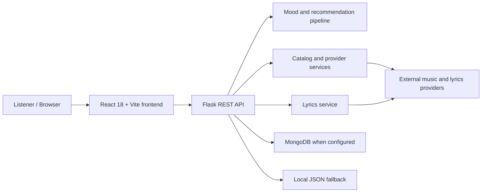

# Sangeet — Current System Architecture

This is a practical overview of the code currently in the repository. For implementation detail and design rationale, see [Architecture Deep-Dive](ARCHITECTURE.md). For routes and payload examples, see [API Reference](API.md).

## System context

## Main responsibilities

| Area | Current location | Responsibility |
|---|---|---|
| Frontend entry | `frontend/src/main.jsx`, `App.jsx` | React application startup and UI composition |
| API client | `frontend/src/api.js` | Frontend-to-backend requests |
| Styling | `frontend/src/index.css`, Tailwind config | Existing visual system |
| API routes | `backend/app.py` | HTTP endpoints and request/response handling |
| Mood/recommendations | `backend/services/nlp_service.py`, `hybrid_pipeline.py` | Text-to-mood analysis and track selection |
| Catalog/search | `catalog_service.py`, provider services | Curated catalog, discovery, and stream resolution |
| Lyrics | `lyrics_service.py` | Lyrics lookup and normalization |
| Persistence | `db_service.py` | User data through MongoDB or JSON fallback |
| Hosting config | `netlify.toml` | Frontend build and edge redirects |

## Main request flows

### Mood/chat discovery

1. The frontend sends a request to `POST /api/chat` or `POST /api/mood`.
2. Flask validates the basic request and calls the hybrid pipeline or NLP service.
3. Service modules classify mood and select or resolve tracks using configured sources and fallbacks.
4. Flask returns JSON to the frontend.

### Search and lyrics

1. The frontend calls the search or lyrics API route.
2. Flask delegates provider lookup and response normalization to service modules.
3. The normalized response is returned to the browser for display and playback.

### User library

1. The frontend calls playlist, liked-song, or history endpoints.
2. Flask calls `db_service.py`.
3. The persistence layer uses MongoDB when configured and available, otherwise its JSON-file fallback.

**Security note:** the current route layer accepts client-supplied user identifiers. This is not a secure authorization boundary. See [Security Review](SECURITY_REVIEW.md) before using real accounts.

## Architecture principles for future changes

- Keep UI components, API routes, service logic, and persistence responsibilities separate.
- Preserve existing endpoint paths and response shapes unless a versioned migration is planned.
- Keep provider integrations behind service modules so providers can be replaced without rewriting the UI.
- Keep optional providers optional; preserve graceful fallback behaviour.
- Make persistence changes through the existing service boundary and provide migrations.
- Add tests before refactoring critical playback, account, and library flows.
- Prefer observable, reversible changes over a large rewrite.

## Future target direction (not implemented)

As usage grows, evaluate the following incrementally rather than introducing infrastructure prematurely:

- A versioned API contract and generated/validated schemas.
- A dedicated authentication/session layer with server-side authorization.
- Managed persistent database with tested backups and migrations.
- Provider adapters with timeouts, retries, caching, and circuit-breaker behaviour.
- Centralized structured logging, metrics, tracing, and alerting.
- Automated unit, integration, browser, accessibility, and security tests.
- Staging and production environments with controlled promotion and rollback.

These are recommendations, not descriptions of features already present.
